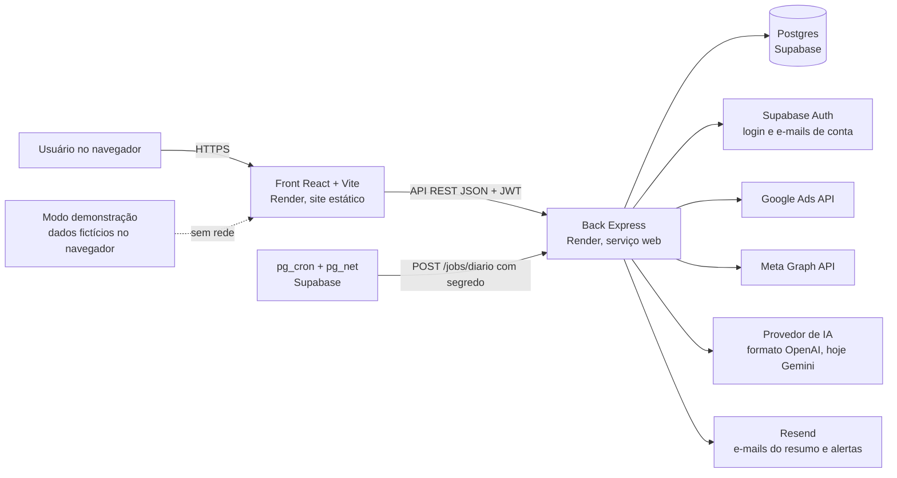
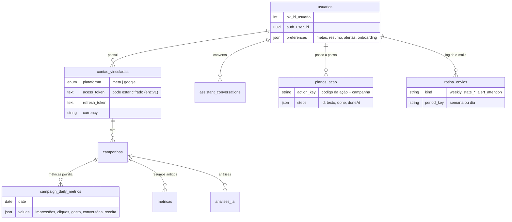
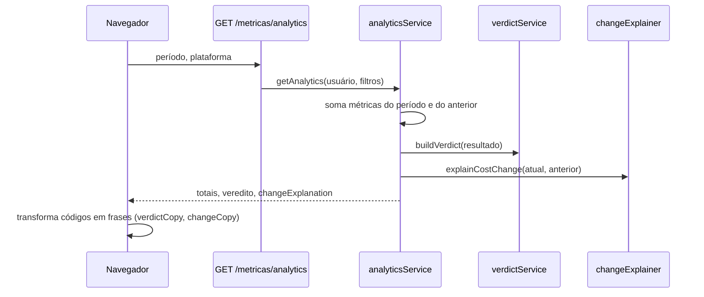
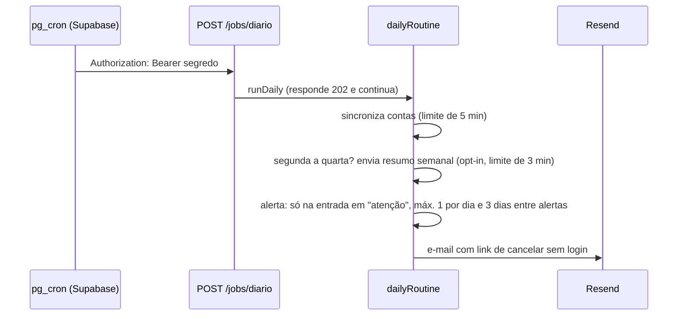

# Arquitetura, dados, segurança e testes do Eyesight

Documento de apoio ao TCC. Os diagramas usam Mermaid (renderizam no GitHub, VS Code e na maioria dos editores de Markdown).

## 1. Visão geral

O Eyesight reúne os números de **Google Ads** e **Meta Ads** (e perfis profissionais do Instagram) num painel que responde, em português
simples, "meus anúncios estão indo bem?", "por que mudou?" e "o que faço agora?".



- **Front** (`eyesight-front`): React 18, Vite, react-router, Recharts, lucide-react. Tema claro/escuro por variáveis CSS. Testes com Vitest + Testing Library; auditoria de acessibilidade com Playwright + axe-core.
- **Back** (`eyesight-backend`): Node + Express, Prisma sobre Postgres (Supabase), testes com `node --test`.
- **Agendamento:** o Render pode "dormir", então quem aciona a rotina diária é o `pg_cron` do Supabase (via `pg_net`), chamando `POST /jobs/diario` com um segredo guardado no Vault.
- **Demonstração:** `/demo` roda inteira no navegador com dados fictícios (`demoApi`), sem login e sem servidor.

## 2. Camadas e responsabilidades (back)

| Camada | Pasta | Exemplos |
|---|---|---|
| Rotas | `src/routes` | `/auth`, `/meta`, `/google`, `/instagram`, `/metricas`, `/ia`, `/jobs`, `/resumo` |
| Controladores | `src/controllers` | validam a entrada, chamam serviços, formatam a resposta |
| Serviços (regra de negócio) | `src/services` | `analyticsService`, `verdictService`, `changeExplainer`, `planService`, `dailyRoutine`, `tokenVault` |
| Validação | `src/validators` | esquemas Zod (entradas estritas) |
| Dados | `prisma/schema.prisma`, `src/config/database.js` | Prisma Client |

**Princípio de projeto:** a regra que importa é **função pura e testável**. Exemplos: `buildVerdict` (veredito), `explainCostChange`
(por que mudou), `evaluateFollowUp` (acompanhamento do plano). A IA nunca calcula números: só explica o que o servidor já calculou.

## 3. Modelo de dados



Decisões de modelagem:
- Cada usuário tem **no máximo uma conta por plataforma** (`@@unique([fk_id_usuario, plataforma])`).
- As métricas por dia ficam em `campaign_daily_metrics` com os valores num JSON, o que permite novas métricas sem mudar o schema.
- Preferências (metas, opt-in do resumo e do alerta, onboarding) ficam em `usuarios.preferences` (JSON), sem tabela nova.
- `rotina_envios` tem `UNIQUE (user_id, kind, period_key)`: garante que o mesmo e-mail da mesma semana/dia não seja reservado duas vezes.
- O acompanhamento do plano usa o JSON dos passos (`doneAt`), sem coluna nova.

## 4. Fluxos principais

### 4.1 Do dado ao veredito



O servidor devolve **códigos e números**; o front os transforma em frases. Isso mantém o texto em um lugar e o cálculo em outro.
O texto do e-mail espelha o do front (`summaryCopy.js` ↔ `verdictCopy.js`).

### 4.2 Por que mudou? (decomposição exata)

`CPC = (CPM/1000)/CTR` e `CPA = CPC / taxa de conversão`. Em logaritmos, `Δln custo = Δln CPM − Δln CTR − Δln conversão`, então a
parcela de cada fator é a sua contribuição dividida pela variação total, e as parcelas somam 100%. O sistema se recusa a explicar quando
há menos de 30 cliques, período incompleto ou variação menor que 5%.

### 4.3 Rotina diária, resumo semanal e alerta



Idempotência: antes de enviar, a rotina "reserva" a linha em `rotina_envios` (chave única); se o envio falha, a reserva é liberada.

## 5. API (resumo)

| Grupo | Rotas principais | Proteção |
|---|---|---|
| `/auth` | cadastro, login, refresh, logout, alterar/redefinir senha, `me` (GET/PUT), `me/contas` | JWT; limites por IP nas sensíveis |
| `/meta`, `/google` | conectar (OAuth), callback, status, campanhas, insights, desconectar | JWT; limite por minuto (Meta) e por hora (desconectar) |
| `/instagram` | status, métricas | JWT; limite por IP |
| `/metricas` | campanhas, geral, resumo, **analytics**, **sincronizar** (5/min por usuário), alertas, **exportar** CSV | JWT; limites |
| `/ia` | status, chat (20/h), análises, **planos** (GET/POST/PATCH de passos), conversas | JWT; limite de uso da IA |
| `/jobs` | `POST /diario` | segredo (comparação em tempo constante) |
| `/resumo` | `POST /teste`, `POST /cancelar` | JWT / token assinado de cancelamento |

## 6. Segurança e privacidade (LGPD)

| Tema | O que existe | Limite honesto / próximo passo |
|---|---|---|
| Autenticação | Supabase Auth + JWT; rotas protegidas por middleware | — |
| Segredos | Em variáveis de ambiente; `.env` fora do Git (front e back); varredura de padrões de chave antes do primeiro commit | Conferir periodicamente |
| Tokens das contas de anúncio | **Criptografia em repouso opcional** (AES-256-GCM, formato `enc:v1:`), compatível com valores antigos em texto; ativa ao definir `TOKEN_ENCRYPTION_KEY` | Ainda desligada até a chave ser configurada no Render; perder a chave obriga a reconectar as contas |
| Banco | RLS ligado nas tabelas; o app acessa pelo servidor | Políticas por usuário não são necessárias enquanto só o servidor acessa |
| Rotina agendada | Segredo no Vault do Supabase; comparação em tempo constante | — |
| Cancelamento de e-mails | Token assinado (HMAC) com validade, sem login | — |
| Limites de uso | Por IP e por usuário; IA limitada por hora | — |
| Cabeçalhos | `helmet` ativo | O CORS está aberto a qualquer origem (`cors()` padrão): como a autenticação é por cabeçalho `Authorization` e não por cookie, o risco é baixo, mas o ideal é restringir ao endereço do front |
| Dados pessoais | Nome, e-mail (no Supabase Auth), telefone e localização opcionais; e-mails só para quem ligou a opção | Documentar exclusão a pedido: ao apagar o usuário, as tabelas ligadas apagam em cascata |
| IA | O servidor monta o contexto; o navegador não envia números; nada é enviado sozinho; sem comparações com "mercado" | O plano gratuito de alguns provedores pode usar o conteúdo enviado para melhorar produtos; avisar o usuário se for adotado em produção |

## 7. Estratégia de testes

| Camada | Ferramenta | O que cobre | Total (11/10/2026) |
|---|---|---|---|
| Back | `node --test` com mocks de módulo | regra de negócio pura (veredito, decomposição, acompanhamento, rotina), controladores, validadores, cofre de tokens | 269 |
| Front | Vitest + Testing Library | componentes, hooks, textos, demonstração, estrutura do tema | 386 |
| Acessibilidade | Playwright + axe-core (`npm run a11y`) | 15 telas × 2 temas × 2 larguras, mais estados (68 combinações) | 0 problemas bloqueantes |
| Tema | `npm run theme:compare` | cores calculadas de cada elemento antes/depois de mudanças de CSS | 0 elementos alterados nas telas do app |

Práticas: TDD (teste escrito e visto falhar antes do código), uma revisão final independente por entrega e registro dos achados menores adiados.

## 8. Como rodar

```bash
# Back
cd eyesight-backend && npm ci && npx prisma generate
node scripts/check-env.mjs        # confere o .env sem mostrar valores
npm test                          # 269 testes
npm run dev                       # ou npm start

# Front
cd eyesight-front && npm ci
npm run dev                       # http://localhost:5173 ; /demo funciona sem back
npm test                          # Vitest
npm run lint && npm run build
npm run a11y                      # auditoria de acessibilidade (Playwright)
```

Variáveis do back (nomes; os valores nunca vão para o Git): `DATABASE_URL`, `DIRECT_URL`, `JWT_SECRET`, `SUPABASE_URL`, `SUPABASE_ANON_KEY`,
`META_APP_ID`, `META_APP_SECRET`, `META_REDIRECT_URI`, `GOOGLE_CLIENT_ID`, `GOOGLE_CLIENT_SECRET`, `GOOGLE_REDIRECT_URI`, `GOOGLE_DEVELOPER_TOKEN`,
`OPENAI_API_KEY`, `OPENAI_BASE_URL`, `OPENAI_MODEL`, `RESEND_API_KEY`, `JOBS_SECRET`, `UNSUBSCRIBE_SECRET`, `FRONTEND_URL`, `BACKEND_URL`,
e a opcional `TOKEN_ENCRYPTION_KEY` (32 bytes em base64: `node -e "console.log(require('crypto').randomBytes(32).toString('base64'))"`).

## 9. Limitações e trabalhos futuros

- Um usuário tem uma conta por plataforma; **várias contas de clientes** (agências) exigem mudar o modelo.
- O acompanhamento do plano é **indício, não prova** (outros fatores influenciam); provar exigiria teste controlado.
- O "ritmo do orçamento" (projeção mensal) precisa de uma configuração mensal que ainda não existe.
- Novos canais (TikTok, LinkedIn), relatório com a marca da agência e plano pago.
- Restringir o CORS, ligar a criptografia dos tokens e adicionar monitoramento de erros em produção.
